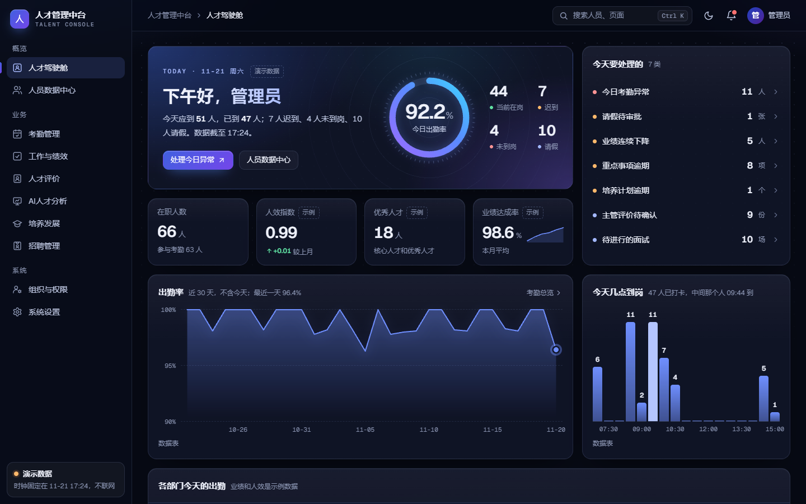
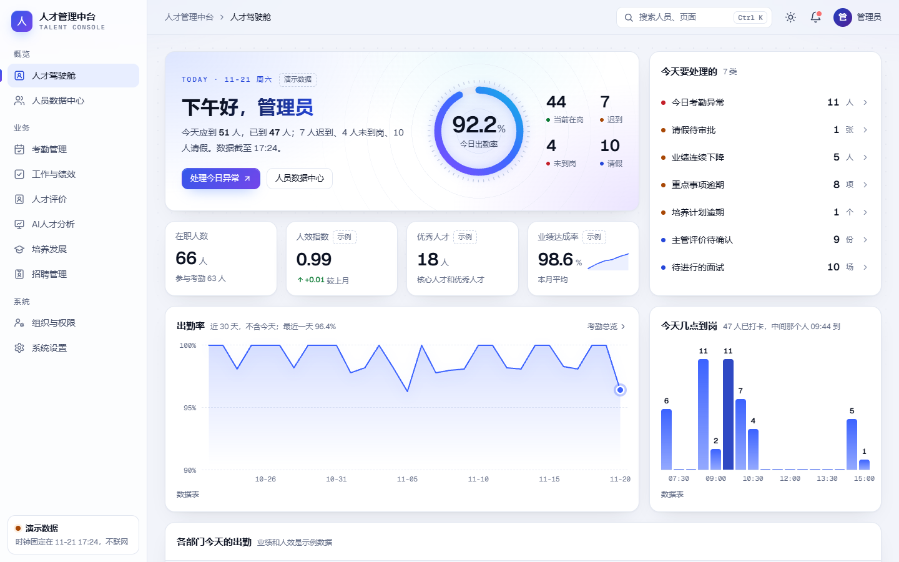
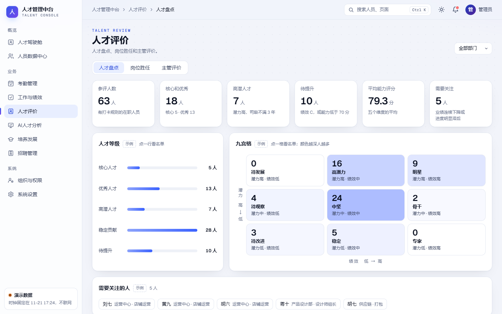

# 人才管理中台（演示）

一个人事数据控制台的前端：考勤、绩效、人才盘点、培养、招聘、组织，十个模块，深色和浅色两套主题。
不用任何第三方库，不用构建，整个目录就是成品。页面上的人和数都是按固定种子生成的示例，不含任何真实信息。

在线演示：<https://winkless213.github.io/talent-console/>

| 浅色主题 | 人员数据中心 | 人才盘点 |
| --- | --- | --- |
|  |  |  |

## 怎么打开

- 放到静态托管上（比如 GitHub Pages）：整个目录原样放上去，打开 `index.html`。所有资源都是相对路径，放在子路径下也可以；数据在浏览器里现算，不需要服务端。
- 在自己电脑上看：Windows 双击 `start.cmd`；或者运行 `node server.js --mock`，再打开 <http://127.0.0.1:18761/>。

直接双击 `index.html` 不行：浏览器不允许从本地文件加载脚本模块，页面上会有一句提示。

本机服务和测试需要 Node.js 20 或更高（开发和测试用的是 25）。浏览器在 Chrome 上验证过；样式用了 `:has()`、容器查询这些比较新的写法，需要近两年的浏览器版本。

## 十个模块

人才驾驶舱、人员数据中心、考勤管理、工作与绩效、人才评价、AI人才分析、培养发展、招聘管理、组织与权限、系统设置。

- 考勤和组织：走的是「企业微信官方接口 → 取数 → 核算」这条真实的链路，演示时接口由一套假实现应答，路径和字段结构与官方接口一致。
- 工作、绩效、评价、培养、招聘：企业微信里没有这些数据，演示时按固定种子生成，页面上都标了「示例」。接上真实企业微信后这些位置显示「待接入」，不放任何编出来的数。
- 「AI提醒」是按固定口径从数据里算出来的，没有调用大模型。每个数怎么算，页面上的「口径说明」里都写了。

## 目录

| 位置 | 内容 |
| --- | --- |
| `core/` | 取数和核算，浏览器和 Node 共用，都是纯函数。`lib.js` 调企业微信官方接口，`sync.js` 取数顺序，`model.js` 考勤核算，`views.js` 各页面的汇总数，`mock.js` 假企业微信，`demo.js` 示例数据 |
| `js/` | 页面。`app.js` 外框和路由，`pages/` 每个模块一个文件，`charts.js` 图，`ui.js` 共用部件，`person.js` 个人档案，`rules.js` 口径 |
| `css/` | `theme.css` 主题变量和通用部件，`people.css`、`pages.css` 各页面 |
| `server.js` | 可选的本机服务，只监听 127.0.0.1 |
| `test/` | 测试，`npm test` |

## 数据和隐私

- 示例数据里人名是「姓 + 数字」的占位名，公司叫「演示公司」，时钟固定；同一个种子每次生成的结果一样。
- 页面只加载本站的脚本、样式和字体，不向任何第三方发请求。
- 接真实企业微信时：企业 ID 和应用 Secret 只放在本机的 `wecom-config.json`（已写进 `.gitignore`），取回的数据只放内存、不存盘；打卡的位置、WiFi、设备信息，通讯录里的手机号、邮箱，请假单里的事由和附件，都不保留。

## 接上真实的企业微信（可选）

1. 把 `wecom-config.example.json` 复制成 `wecom-config.json`，填上企业 ID 和应用 Secret。
2. 运行 `node server.js`，打开它打印出来的本机地址。

只用官方文档里的接口，清单在页面的「系统设置 → 数据来源」里。这一版整理成展示项目以后只用假接口验证过，没有再对真实的企业微信实测。

法定节假日只内置了 2026 年的放假和调休安排（打卡规则开了「同步法定节假日」的人才用得到），2027 年的还没有加，在 `core/model.js` 开头。

## 测试

`npm test`，78 个用例：考勤核算的口径、示例数据前后一致、页面对数据里的文字和地址里带的条件做转义、导出的表格不会被当成公式、本机服务的访问控制、两套主题的文字对比度。

## 键盘和配色

- 打开档案、各个弹层、搜索面板（Ctrl K）、筛选、翻页都可以只用键盘完成；弹层打开时焦点留在弹层里，关掉后回到原来的位置。
- 日期框用键盘输入时，敲完按回车或者离开这个框才生效；用日历点选是马上生效。
- 两套主题下，文字和它的底色之间的对比度不低于 4.5:1（大字不低于 3:1）。
- 还没做到的：输入框和下拉框的边线比较淡，对比度不到 3:1，靠底色、图标和文字来辨认；图上逐点的说明只在鼠标悬停时出现，用键盘的话看图下面的「数据表」。

## 用到的第三方素材

- 字体：Geist、Geist Mono，SIL Open Font License 1.1，许可证在 `fonts/`。只带拉丁字母，中文用系统自带的字体。
- 图标：一部分取自 [Lucide](https://lucide.dev)（ISC 许可，其中有些源自 Feather，MIT 许可）或在它的基础上改画，其余是自己画的。许可证原文在 `licenses/lucide.txt`。

除此之外没有其他依赖。

## 许可

这个仓库自己的代码用 MIT 许可，全文在 `LICENSE`。字体和图标是别人的作品，各按上一节写的许可。
